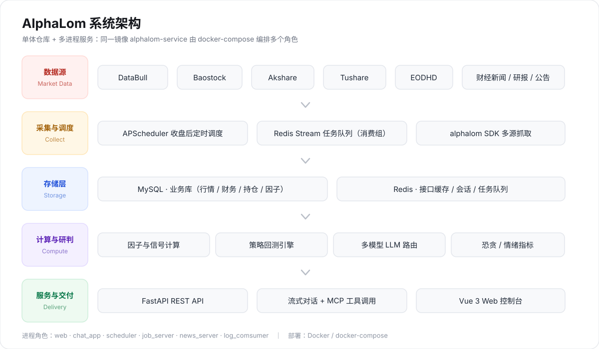
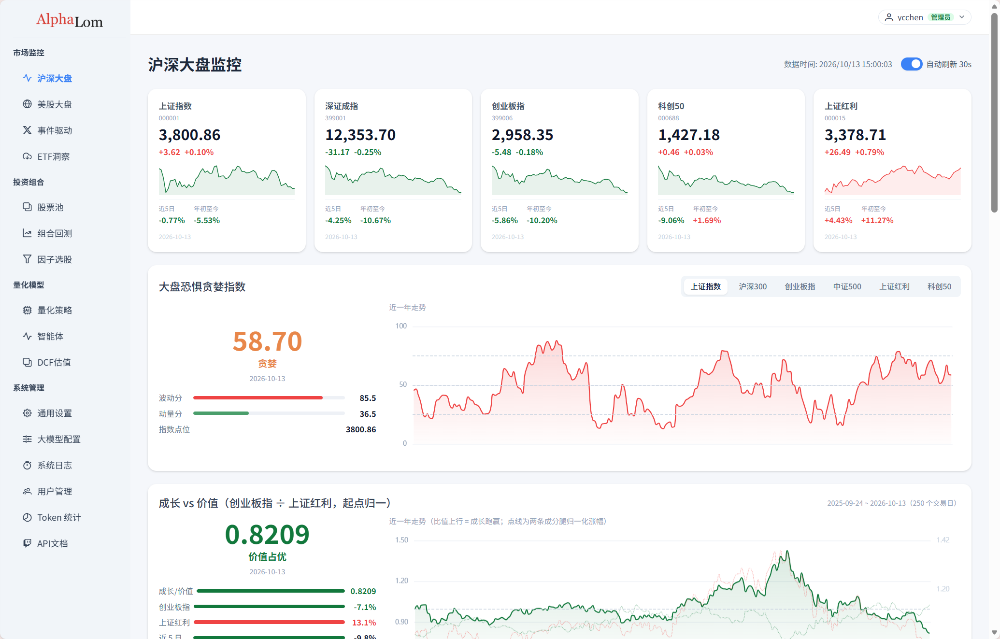
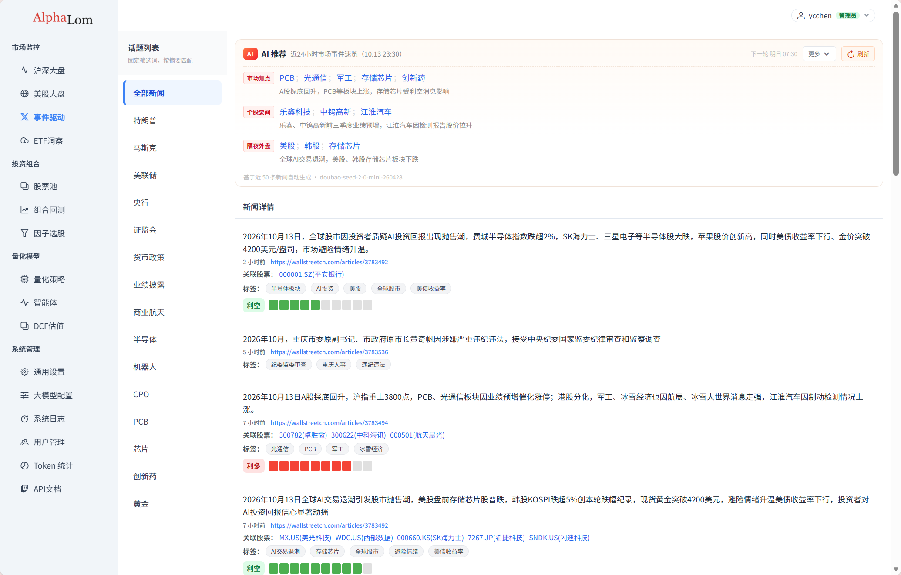
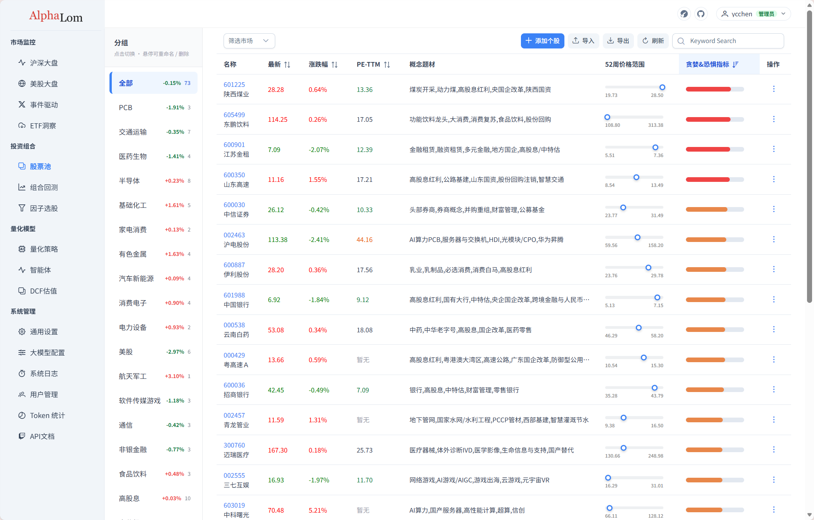
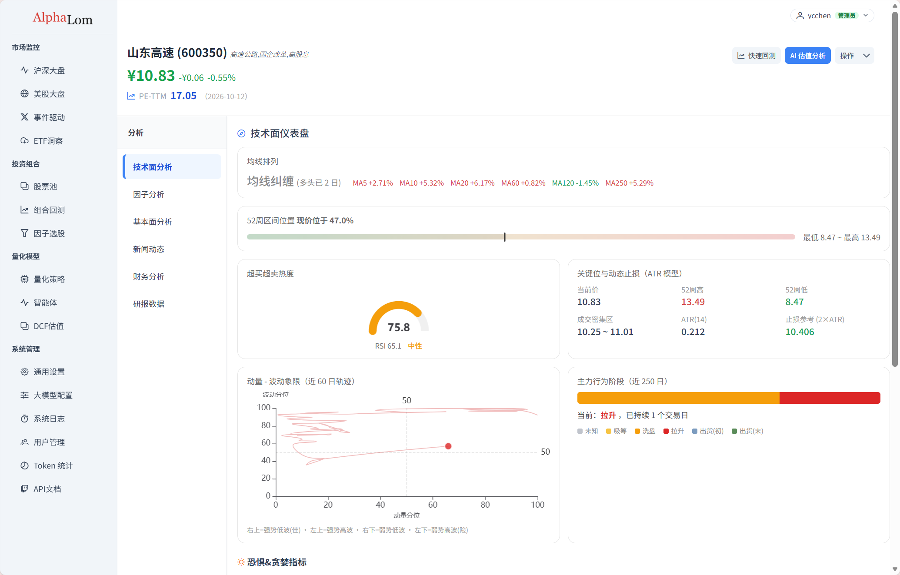
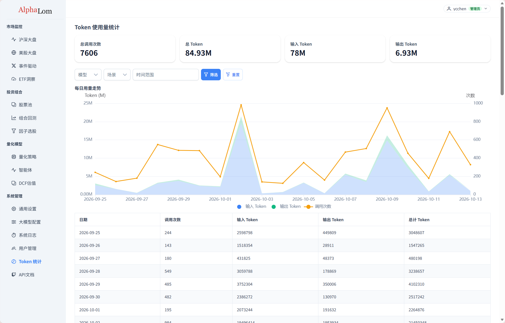
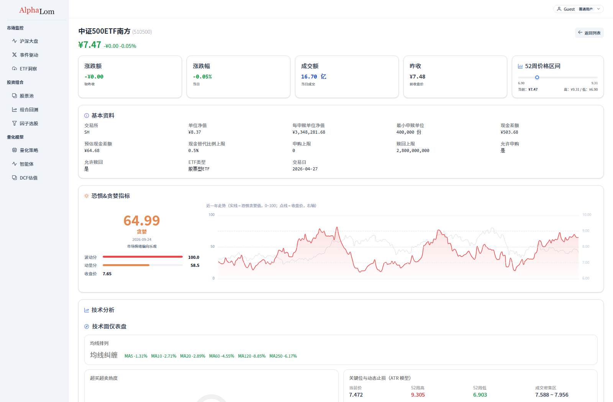

<div align="center">

<picture>
  <source media="(prefers-color-scheme: dark)" srcset="public/images/alphalom-logo-dark.png">
  
</picture>

### 一体化金融数据分析与智能投研平台

**以 Alpha（超额收益）为标的、以 Loom（织机）为喻**
把散落在行情、财务、新闻与另类数据中的市场信号，编织成可执行的投资决策。

[](#)
[](LICENSE)
[](#)
[](#)
[](#)
[](#)
[](#)
[](#)

🌐 **官网**：[https://www.alphalom.com/](https://www.alphalom.com/)

</div>

---

## 📖 项目简介

AlphaLom 面向个人量化投资者与投研团队，提供 **多源数据采集 → 因子与信号计算 → LLM 智能研判 → 投资组合管理 → 策略回测** 全链路能力，以 REST API + Web 控制台双形态交付。

平台原生集成多路大语言模型（火山方舟 · 阿里云百炼 · DeepSeek · 智谱 GLM · SiliconFlow · 腾讯云混元 · 百度云千帆），按场景画像路由，将 LLM 系统性地嵌入财报解读、新闻情绪投票、策略代码生成与 AI 辅助调仓等投研流程。模型路由由 `config.llm_model_setting` + 系统设置页共同决定，不改代码即可切换场景 → 模型。

## ✨ 功能特性

| | 模块 | 能力 |
|:--:|:--|:--|
| 📈 | **市场监控** | 沪深大盘（指数、申万行业涨跌、板块情绪、市场温度计、板块轮动）与美股大盘（11 个指数日线卡片，VIX 反向配色）；事件驱动流按题材聚合全市场新闻，附关联个股、标签与多空情绪，每小时 AI 速览 |
| 🎯 | **个股监控** | 支持 A 股 / 港股 / 美股关键字搜索添加；详情整合 K 线与技术指标、主力行为阶段、恐贪指数、财务评分与 DCF 估值；列表页 KeepAlive 缓存，返回保留分组与分页记忆 |
| 🧮 | **技术面因子分析** | 基于 2130 万行 / 1888 标的 / 107 因子的因子库：因子看板、技术面仪表盘、因子雷达与行业对比、因子选股器与技术信号扫描（纯规则计算，不消耗大模型额度） |
| 🛰️ | **ETF 监控** | 监控清单持久化，支持搜索添加与删除，**添加即自动回填因子历史**（不等日更）；详情含 K 线与量价指标、基本资料、成分股穿透与技术面分析面板 |
| 💼 | **投资组合** | 总资产 / 仓位 / 浮动盈亏 / 夏普比率 / 最大回撤 / 年化收益，净值曲线、持仓行业分布、交易复盘与 AI 调仓计划 |
| 🔁 | **量化策略与回测** | 多策略账户信号总览、回测参数设置、回测记录与逐笔明细、QuantStats 绩效报告 |
| 🧠 | **AI 分析** | 统一封装多路 LLM 按任务画像路由：研报生成、多模型新闻投票、策略代码生成，以及支持 MCP 工具调用的 AI 对话 |
| 👥 | **多用户与权限** | 管理员建号（不开放自助注册），令牌存 Redis、7 天滑动续期；股票池 / 投资组合 / ETF 自选按账号隔离；越权一律返回 404 |
| 🧩 | **数据接口** | 覆盖市场、股票、ETF、组合、回测、因子六大域的 REST 接口；另提供 API Key 鉴权的对外开放 API，可直接对接第三方交易系统 |

## 🧱 系统架构



「单体仓库 + 多进程服务」：同一镜像 `alphalom-service` 由 `docker-compose.yaml` 编排多个角色。

| 服务 | 端口 | 入口 | 职责 |
|:--|:--|:--|:--|
| `web` | 8080 | `run_fastapi.py` | FastAPI REST API（静态资源 + SPA，含 `/api/v1/chat` 流式对话） |
| `scheduler` | — | `scheduler.py` | 收盘后数据 / 因子 / 信号调度（任务见 `scheduler_jobs.yaml`） |
| `job_server` | — | `job/job_server.py` | Redis Stream 任务消费者（消费组） |
| `news_server` | — | `job/news_server.py` | 新闻聚合 |
| `log_comsumer` | — | `log_comsumer.py` | 日志消费 |

**后端模块**：`app/`（应用工厂 · 缓存 · 统一响应）· `routes/`（16 个路由）· `service/`（33 个业务模块）· `llms/`（多模型封装 + 提示词模板）· `backtest/`（回测引擎）· `job/`（17 个离线任务）· `models/`（DB / Redis / 任务队列）· `utils/`

**前端视图**（`src/views/`）：`market` · `stock` · `etf` · `portfolios` · `quant` · `ai` · `trading` · `user` · `system` · `auth` · `uikit`

## 🛠 技术栈

| 层次 | 选型 |
|:--|:--|
| 🎨 **前端** | Vue 3 · Vite · PrimeVue · Tailwind · klinecharts / ECharts · Monaco Editor |
| ⚙️ **后端** | Python 3.11+ · FastAPI · SQLAlchemy 2.0 · Pydantic 2 · uvicorn |
| 🗄️ **存储 / 中间件** | MySQL（业务库）· Redis（接口缓存 + 会话 + Stream 任务队列） |
| 🤖 **模型层** | 火山方舟（豆包 / GLM）· 阿里云百炼 · DeepSeek · 智谱 GLM · SiliconFlow · 腾讯云混元 · 百度云千帆——按场景路由，可热切换 |
| 📡 **数据源** | DataBull（主力行情 / 财务数据 SDK）· 同花顺快讯 |
| 🚀 **调度 / 部署** | APScheduler · Docker / docker-compose |

## 🎯 关键设计

- **交易时段缓存**：15:00–09:00（盘后）强制更换缓存键回源，避免盘后行情被长期缓存。
- **指数卡片双页复用**：沪深与美股大盘页共用 `IndexCard.vue` 与 `index_card_common.py`；美股指数只有日线无盘中实时价，当日涨跌用相邻收盘价自算；VIX 为波动率指数，卡片反向着色（涨 = 恐慌）。
- **列表页状态记忆**：股票池 / ETF 页用 `<KeepAlive :include>` 只缓存列表组件，返回时分组、分页与排序不重置。
- **入池即回填**：ETF 添加时立即在后台补算因子历史，不等 20:10 日更，避免新标的首日因子退化（52 周分位恒为 100%/0%）。
- **长假后调度保护**：交易日历缓存键随日期变化，防止长假后「日历缓存固化」把当天日更整体跳过。
- **多模型 LLM 路由**：按场景分配模型（DCF 走 `deepseek-v4-flash`、技术面走 `doubao-seed-2-0-mini`、新闻分析按序回退等）；路由表只登记实测可用模型，避免「模型列表存在 ≠ 账号可用」。
- **因子库查询红线**：`factor_values` 为 EAV 长表，取最新值必须先以 `trade_date IN (<最近 K 个交易日>)` 命中主键首列，**绝不写 range 条件**（实测 57s → 1.3s）；「最新交易日」取最近 K 个有数据交易日的并集，不能取全表 `MAX`。
- **定时调度**：`scheduler.py` 加载 `scheduler_jobs.yaml`（Asia/Shanghai），16:00 起依次执行回测、调仓、数据刷新、因子、信号、估值等任务；改时间只动 YAML，部署前 `python scheduler.py --check` 校验。
- **并发模型**：绝大多数路由为同步 `def`，由 anyio 线程池承接阻塞调用获得真并发；worker 数与线程池上限配置化。
- **真实 IP**：维护可信代理白名单，仅信任来自可信代理的 `X-Forwarded-For`，防 IP 伪造。
- **增量数据库迁移**：`create_all(checkfirst=True)` 只建「不存在的表」，对已有表加的列不会自动出现。所有**已存在表**的后续变更（新增列、新增索引）统一在 `models/init_db.py` 的 `_SCHEMA_UPGRADES` / `_INDEX_UPGRADES` / `_NONUNIQUE_INDEX_UPGRADES` 三个元组里登记一条，`ensure_schema_upgrades()` 在服务启动时幂等补列/补索引——无需手写迁移脚本，部署即生效。
- **网站统计代码**：管理员在「系统管理 · 通用设置」粘贴统计平台（百度统计 / CNZZ / Google Analytics 等）的 `<script>` 片段，整段存 `system_setting` 表；前端启动时拉取并把 `<script>` 重建后注入页面执行（每次页面加载仅一次，避免重复计数），未登录 / 接口不可用时静默跳过，绝不影响主流程。

## 🌐 对外开放 API（OpenAPI）

基于 API Key 鉴权、只读的开放接口，挂载于 `/api/ext` 子应用，自带独立 Swagger 文档（`/api/ext/docs`），覆盖：

- **投资组合**（`/portfolios`）——组合列表 / 详情 / 每日统计 / 交易流水
- **股票池**（`/stocks/pools`、`/stocks/watchlist`）——分组与成员，含行业、最新价、恐贪、主力阶段、52 周区间
- **个股分析**（`/stocks/{symbol}/...`）——概况、基本面评分、技术面因子、财务报表、恐贪与聚合端点；支持批量整池拉取（计 1 次配额）与技术信号
- **ETF**（`/etfs/...`）——监控清单、目录搜索、基本资料、历史行情、成分股、PCF 与权重估算、恐贪与聚合端点

密钥在「系统管理 → API Key」自助管理（创建 / 改名 / 启停 / 吊销，明文仅返回一次），每日调用配额（429 + `Retry-After`），按账号隔离并剥离敏感字段。调用方式与全部端点见 👉 **[public/docs/EXTERNAL_API.md](public/docs/EXTERNAL_API.md)**，部署后可访问 `<域名或IP>:8080/api/ext/docs` 试调。

## 🧮 技术面因子分析

在因子库（`factor_values`）之上提供四层分析能力（接口挂在 `/factor/*`）：L0 因子字典与看板、L1 技术面仪表盘（均线排列 · 动量-波动象限 · 超买超卖 · ATR 动态止损）、L2 因子雷达与同行业对比、L3 因子选股器与技术信号扫描。前端入口为个股详情「技术面」Tab 与 `/quant/factor_screen` 页面，设计说明见 👉 **[public/docs/技术面分析专业功能方案.md](public/docs/技术面分析专业功能方案.md)**

> ⚠️ **数值口径**（写阈值前先量 min/max）：`mom_*` / `bias_*` / `vol_*` 为小数（`0.03` = 3%）；`rsi_14` / `52week_position` 为 0~100；`closing_strength` 为 0~1；`turnover_*` 为成交量均值；`atr_14` 为价格。

## 👥 多用户与鉴权

不开放自助注册，账号一律由管理员在「系统管理 · 用户管理」创建。

- **登录**：用户名 / 邮箱 + 密码，令牌存 Redis（前缀 `alphalom:auth:token:`，7 天滑动续期）
- **隔离**：股票池、投资组合、ETF 自选按账号隔离；`user_id` 严禁进可写白名单
- **越权**：一律返回 404，不通过状态码泄露资源存在性
- **载荷**：只返回 DTO（`to_dict()`），绝不直接序列化 ORM 对象
- **改密提示**：任意用户均可自助改密（`POST /auth/change-password`）；首次安装生成的默认管理员 / 仍使用出厂弱密码者，登录后自动弹出「安全风险提示」弹窗提醒尽快修改，改密后自动消除

## 📁 目录结构

```
alphalom/
├── run_fastapi.py        # FastAPI REST 入口（含流式对话 /api/v1/chat）
├── scheduler.py          # 定时任务入口（配置驱动，任务见 scheduler_jobs.yaml）
├── log_comsumer.py       # 日志消费入口
├── config.py             # 全局配置（按 ENV 加载 .env / .env.<env>）
├── app/ routes/ service/ llms/ backtest/ job/ models/ utils/
├── src/                  # Vue 前端源码
├── public/               # 静态资源（images/ 品牌资源、readme/ 配图、docs/ 专题文档）
├── install/              # SQL 初始化脚本
├── dist/                 # 前端构建产物（由 FastAPI SPA 路由直接服务）
├── docker-compose.yaml   # 服务编排
├── Dockerfile
└── requirements.txt
```

## 🚀 快速开始

```bash
pip install -r requirements.txt
npm install
cp .env.sample .env       # 配置数据库 / Redis / 各 LLM API Key
```

`config.py` 按环境变量 `ENV` 加载 `.env` 或 `.env.<ENV>`，未找到时回退到进程环境变量。主要变量：`DATABASE_CONN_STR`、`REDIS_*`、`JOB_QUEUE_*`、`*_APIKEY`、`DATABULL_HOST`、`DATABULL_KEY`、`MCP_HOST`。

### 首次启动与默认管理员

首次启动（数据库为空）会自动创建默认管理员账号 `admin`，并**在后端启动日志 / `docker logs` 中醒目打印登录密码**——未配置 `ADMIN_PASSWORD` 时密码为系统随机生成的强密码（不再使用固定弱密码 `admin123456`）。登录后会自动弹出「安全风险提示」弹窗，点「立即修改」就地改密（点「稍后处理」仅本次会话不再打扰，重新登录仍会提醒）；也可在「系统管理 → 用户管理」中修改。

> 可在 `.env` 用 `ADMIN_PASSWORD` 预置管理员密码（部署脚本 / 无人值守场景），此时密码以你的配置为准，日志不再回显明文。`ADMIN_USERNAME` 亦可覆盖默认用户名。出于安全，仍建议登录后立即修改。

**并发配置**（`config.py` 的 `server_setting`）：

| 变量 | 默认 | 说明 |
|:--|:--|:--|
| `WEB_HOST` | `0.0.0.0` | 监听地址 |
| `WEB_PORT` | `8080` | 监听端口 |
| `WEB_WORKERS` | `1` | uvicorn 多进程 worker 数 |
| `WEB_THREAD_POOL_SIZE` | `40` | 单进程 anyio 线程池上限（仅约束同步 `def` 路由；调大前注意 DB 连接池容量，单进程最多 80 条连接） |

### 启动服务

```bash
python run_fastapi.py          # 主服务（dev 自动热重载，含流式对话）
python scheduler.py            # 定时调度
npm run dev                    # Vite 开发服务器
npm run build                  # 构建到 dist/（由 FastAPI SPA 路由直接服务）
docker-compose up -d           # 或一键编排全部服务
```

### Docker 构建与部署

`./docker.sh` 管理镜像与服务：`all` / `base` / `build` / `up` / `down` / `restart` / `status` / `logs` / `clean` / `help`，无参数默认「构建并启动」。

## 🖼 界面预览

<table>
<tr>
<td width="50%">

<b>沪深大盘监控</b><br>指数行情卡片 + 大盘恐惧贪婪指数 + 成长/价值轮动，申万行业涨跌排行（一 / 二 / 三级可切换）
</td>
<td width="50%">

<b>事件驱动</b><br>AI 事件驱动速览（按时间展示）+ 按题材聚合全市场新闻，附关联个股与多空情绪
</td>
</tr>
<tr>
<td width="50%">

<b>股票池（个股监控）</b><br>左侧分组含<strong>组内等权涨跌幅</strong>；主力行为阶段、概念题材、52 周价格区间
</td>
<td width="50%">

<b>个股详情</b><br>K 线走势（多周期 / 多指标切换）+ 技术面仪表盘：均线排列、超买超卖热度、关键位与 ATR 动态止损
</td>
</tr>
<tr>
<td width="50%">

<b>Token 统计</b><br>可视化统计分析 Token 用量情况
</td>
<td width="50%">

<b>ETF 详情</b><br>基本资料、恐惧贪婪指标、历史走势，申赎清单（PCF）成分股穿透与快捷入池
</td>
</tr>
</table>

> 截图取自真实运行实例（1600×1050、普通用户视角）；另有「市场监控 → 美股大盘」页一行平铺 11 个美股指数卡片，VIX 等波动率指数按「涨 = 恐慌」反向着色。

## 👤 作者

**Yc** —— `yccheni@163.com`

## 📄 许可证

本项目基于 [Apache License 2.0](LICENSE) 开源。
